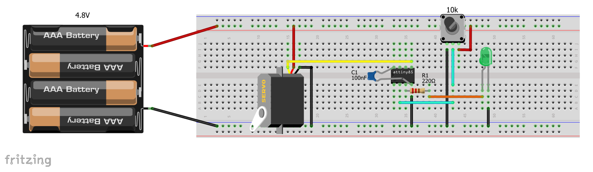
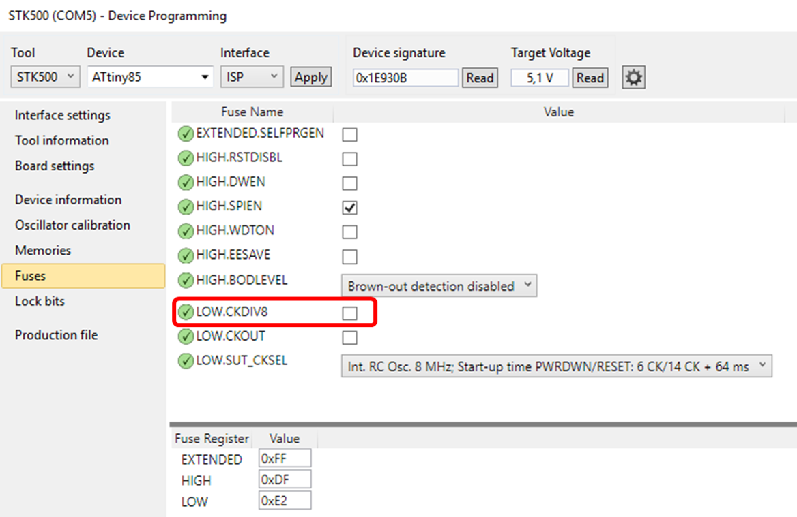

# ATTINY85 Servo Control

> **⚠️ DISCLAIMER: AI-GENERATED CONTENT**
>
> **This code and documentation have been generated using AI assistance and are NOT YET TESTED on actual hardware.**
>
> **IMPORTANT WARNINGS:**
>
> - The hardware PWM implementation described here has not been verified on physical ATtiny85 devices
> - Fuse settings and PlatformIO configurations are theoretical and may require adjustments
> - Electrical specifications and pin assignments should be double-checked against the official ATtiny85 datasheet
> - **Use at your own risk** - incorrect fuse programming can permanently damage your microcontroller
> - **Always verify all configurations** before programming fuses or deploying to hardware
>
> **Recommendation:** Thoroughly test and validate all aspects of this implementation before using in any project.

[](https://en.wikipedia.org/wiki/MIT_License)

An RC servo control using an [AVR ATTINY85 microcontroller](https://www.microchip.com/wwwproducts/en/ATtiny85). This implementation uses **hardware PWM** for high-precision servo control with ~1 µs resolution. The system generates a 50 Hz PWM signal (20 ms period) with pulse widths ranging from 1-2 ms, providing smooth and jitter-free servo operation.

## Features

- **High Resolution**: ~1000 discrete servo positions (vs. previous 256 steps)
- **Hardware PWM**: Zero interrupt overhead and jitter-free operation using Timer1's OC1B output
- **Precision**: ~1 µs timing resolution with 0.09° per step (improved from 0.35°/step)
- **Standard RC Servo Compatible**: 50 Hz PWM with 1-2 ms pulse width range
- **10-bit ADC Control**: Potentiometer input provides full 0-1023 range mapped to servo positions
- **LED Indicator**: Shows when servo is near center position (±25 µs window)
- **Low CPU Load**: Hardware timer handles all PWM generation automatically
- **Robust Design**: Separate power considerations and noise immunity for reliable operation

## Technical Specifications

- **Timer Configuration**: Timer1 Fast PWM mode with OCR1C as TOP
- **Clock Frequency**: 8 MHz CPU with prescaler/8 → 1 MHz timer clock
- **PWM Period**: 20,000 µs (50 Hz frame rate)
- **Pulse Range**: 1000-2000 µs (1-2 ms)
- **Resolution**: 1 µs per timer tick
- **Pin Assignment**:
  - PB4 (OC1B): Servo signal output
  - PB3 (ADC3): Potentiometer input (10kΩ recommended)
  - PB0: LED indicator output (use 200Ω resistor)

## Key Improvements from Previous Implementation

This updated implementation represents a significant improvement over the earlier interrupt-driven approach:

### Previous Implementation (8-bit ISR-based)

- **Resolution**: 256 steps (8-bit) over 1 ms range → 0.35° per step
- **Method**: Interrupt Service Routine (ISR) with Timer1 overflow and compare interrupts
- **Timer Frequency**: 250 kHz (4 µs ticks) using CK/32 prescaler
- **CPU Load**: High interrupt overhead with potential jitter
- **Complexity**: Required careful ISR timing management

### New Implementation (Hardware PWM)

- **Resolution**: ~1000 steps over 1 ms range → 0.09° per step (nearly 4× improvement)
- **Method**: Pure hardware PWM using Timer1's Fast PWM mode with OCR1C as TOP
- **Timer Frequency**: 1 MHz (1 µs ticks) using CK/8 prescaler
- **CPU Load**: Minimal - hardware handles all PWM generation
- **Reliability**: Zero jitter, deterministic timing, immune to interrupt latency

### Benefits of the Hardware PWM Approach

- **Smoother Motion**: Higher resolution provides much smoother servo movement
- **Better Performance**: No CPU cycles wasted on interrupt handling
- **More Reliable**: Hardware-generated timing eliminates software-induced jitter
- **Simpler Code**: Less complex than ISR-based timing management
- **Power Efficient**: Lower CPU utilization allows for power-saving modes

## Electrical Considerations

### Power Supply Requirements

- **MCU Power**: 3.3V - 5V (ensure voltage matches your programmer/system)
- **Servo Power**: Typically 5-6V (check your specific servo specifications)
- **Shared Ground**: **Critical** - MCU and servo must share a common ground reference
- **Separate Power Rails**: Use separate power supplies for servo and MCU to avoid noise and voltage drops
- **Bulk Capacitance**: Place 100-1000µF capacitor near servo connector to handle current spikes

### Signal Integrity

- **Short Signal Leads**: Keep servo signal wire as short as practical
- **Ground Reference**: Route signal wire with a solid ground reference to minimize noise
- **EMI Considerations**: Servo motors generate electrical noise - proper grounding and decoupling is essential

### LED Indicator

- **Current Limiting**: Use 200Ω resistor in series with LED
- **Voltage Drop**: Account for ~2V LED forward voltage in your calculations

## Development Environment Setup

### VS Code with PlatformIO

This project is now developed using **VS Code** with the **PlatformIO** extension, providing a modern, cross-platform development environment for AVR microcontrollers.

#### Prerequisites

1. **Install VS Code**: Download from [https://code.visualstudio.com/](https://code.visualstudio.com/)
2. **Install PlatformIO Extension**: Search for "PlatformIO IDE" in VS Code extensions and install
3. **AVR Toolchain**: PlatformIO will automatically download the required AVR-GCC toolchain

#### Project Structure

```text
ATTINY85-Servo-Control/
├── platformio.ini          # PlatformIO configuration
├── src/
│   └── main.c              # Main source code
├── include/                # Header files (if any)
├── lib/                    # Project libraries
├── test/                   # Unit tests
└── README.md               # This file
```

### Building and Uploading

1. **Open Project**: File → Open Folder → Select project directory
2. **Build**: Click the checkmark (✓) in the PlatformIO toolbar or use `Ctrl+Alt+B`
3. **Upload**: Click the arrow (→) in the PlatformIO toolbar or use `Ctrl+Alt+U`
4. **Serial Monitor**: Click the plug icon to monitor serial output (if using Serial)

### PlatformIO Configuration (platformio.ini)

Create a `platformio.ini` file in your project root with the following configuration:

```ini
[env:attiny85]
platform = atmelavr
board = attiny85
framework =

; Clock configuration for 8MHz
board_build.f_cpu = 8000000L

; Fuse settings for 8MHz internal oscillator (CKDIV8 disabled)
board_fuses.lfuse = 0xE2
board_fuses.hfuse = 0xDF
board_fuses.efuse = 0xFF

; Programmer configuration (adjust for your hardware)
upload_protocol = usbasp
upload_flags =
    -B 4
    -v

; Alternative programmers (uncomment as needed):
; upload_protocol = arduinoisp
; upload_protocol = avrisp2
; upload_protocol = usbtiny

; Build flags
build_flags =
    -Os
    -ffunction-sections
    -fdata-sections
```

**Note**: The `framework =` line is left empty as we're using bare AVR-GCC without Arduino framework.

## Example Breadboard Configuration

The code needs to be programmed on the device via any ISP programmer compatible with PlatformIO (USBasp, Arduino as ISP, etc.).



## Credits

- The original idea was found in the [AVR Freaks Forum](https://www.avrfreaks.net/comment/810846#comment-810846) posted by user **JimK**
- Hardware PWM implementation developed by Andreas Ennemoser (2025)
- PlatformIO migration and modern development setup by Andreas Ennemoser (2025)

## Hardware Configuration Requirements

- For the code to work the CPU needs to run at 8 MHz (this is NOT the factory default)
- The fuse **CKDIV8** has to be unset, otherwise the CPU would run at 1 MHz
- As an alternative the **CKDIV8** could be left as is (factory default), but then the prescaler for the *8-bit Timer/Counter1* has to be set to **4** (using the CS1x bits in the *8-bit Timer/Counter1* control register TCCR1). This alternative is untested.



### Fuse Configuration

#### Using PlatformIO

Fuses can be configured in the `platformio.ini` file and programmed using PlatformIO commands:

```ini
[env:attiny85]
platform = atmelavr
board = attiny85
framework = arduino

; Fuse settings for 8MHz internal oscillator
; Low Fuse: 0xE2 (8MHz internal, no prescaler)
; High Fuse: 0xDF (default)
; Extended Fuse: 0xFF (default)
board_fuses.lfuse = 0xE2
board_fuses.hfuse = 0xDF
board_fuses.efuse = 0xFF

; Upload protocol (adjust based on your programmer)
upload_protocol = usbasp
upload_flags = -B 4
```

**Programming fuses with PlatformIO:**

```bash
# Set fuses (be careful - incorrect fuses can brick your device!)
pio run -t fuses

# Or use individual commands
avrdude -c usbasp -p attiny85 -U lfuse:w:0xE2:m -U hfuse:w:0xDF:m -U efuse:w:0xFF:m
```

#### Alternative: Using avrdude directly

```bash
# Set fuses for 8MHz operation (CKDIV8 disabled)
avrdude -c usbasp -p attiny85 -U lfuse:w:0xE2:m -U hfuse:w:0xDF:m -U efuse:w:0xFF:m

# Verify fuse settings
avrdude -c usbasp -p attiny85 -U lfuse:r:-:h -U hfuse:r:-:h -U efuse:r:-:h
```

**⚠️ Warning**: Incorrect fuse settings can make your ATtiny85 unresponsive. Double-check fuse values before programming!

## Troubleshooting

### Common PlatformIO Issues

1. **Upload Failed**:
   - Check programmer connection and USB cable
   - Verify `upload_protocol` in platformio.ini matches your programmer
   - Try different `upload_flags` (e.g., `-B 10` for slower programming)

2. **Compilation Errors**:
   - Ensure `main.c` is in the `src/` folder
   - Check that `framework =` is empty (no Arduino framework)
   - Verify AVR-GCC toolchain installation via PlatformIO

3. **Servo Not Working**:
   - Verify 8MHz clock configuration (check fuses)
   - Ensure proper power supply connections (separate for MCU and servo)
   - Check servo signal wire connection to PB4 (OC1B)

4. **Fuse Programming Issues**:
   - Use `-B 4` or higher flag for stable communication
   - Try different programmer software (avrdude, etc.)
   - Double-check fuse calculations before programming

### Migration from Atmel Studio

If migrating from Atmel Studio 7:

1. **Create new PlatformIO project**: Use "New Project" in PlatformIO
2. **Copy source code**: Move `main.c` to `src/` folder
3. **Configure platformio.ini**: Use the configuration shown above
4. **Update includes**: Change from `#include <avr/io.h>` (already correct)
5. **Build and test**: Use PlatformIO build system instead of Atmel Studio

## Additional Information

- Official MICROCHIP [ATTINY85 datasheet](http://ww1.microchip.com/downloads/en/DeviceDoc/Atmel-2586-AVR-8-bit-Microcontroller-ATtiny25-ATtiny45-ATtiny85_Datasheet.pdf)
- [PlatformIO ATtiny85 Documentation](https://docs.platformio.org/en/latest/boards/atmelavr/attiny85.html)
- [AVR Fuse Calculator](https://www.engbedded.com/fusecalc/) - Online tool for fuse calculations

---

Distributed under the MIT license. See [LICENSE](https://github.com/chiefenne/ATTINY85-Servo-Control/blob/master/LICENSE) for more information.


